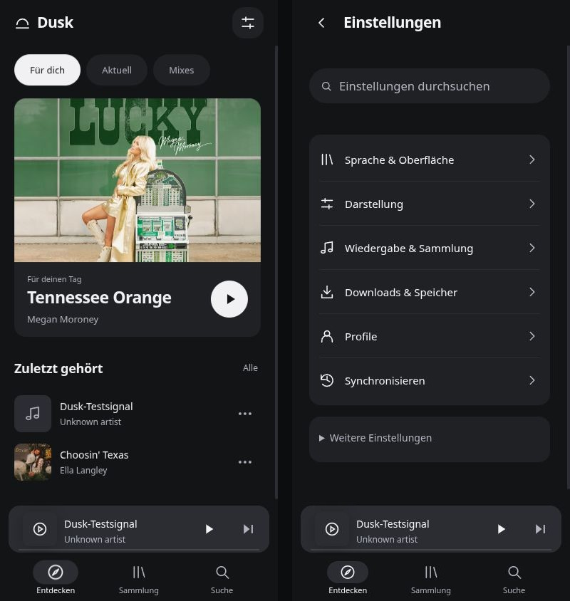

# Dusk für iPhone

Ein dunkler Musikplayer mit ruhiger Oberfläche, drei Hauptbereichen, anpassbaren Themes und automatischer deutscher/englischer Sprachwahl. Technische Grundlage: [Muriel](https://github.com/cloverscripts/riff-muriel) und Riff, MIT-lizenziert. Die ursprüngliche Projektdokumentation liegt unter [docs/UPSTREAM_README.md](docs/UPSTREAM_README.md).



## Stand

Die mobile Oberfläche ist an Player, Suche, Bibliothek und Downloadverwaltung angeschlossen. Lokaler Audioimport, Wiedergabe, Pause, Spulen, Favoriten, Queue und Playlist-Erstellung sind im Browser geprüft. 317 Tests bestanden; einer übersprungen.

**YouTube-Wiedergabe ist noch nicht zuverlässig:** Der getestete Audioabruf wurde mit einer Bot-Anmeldung abgewiesen. Ein funktionierender Gesamtkatalog und YouTube-Offline-Downloads sind nicht zugesichert. Native Hintergrundwiedergabe und Sideloading brauchen einen echten iPhone-Test.

## iPhone-Build

[Erfolgreicher Mac-Build mit Dusk-IPA](https://github.com/zxypablo11/dusk-ios/actions/runs/42917861317). Die IPA ist unsigniert und muss zur Installation mit einem Sideloading-Werkzeug signiert werden. Unter Actions → „Dusk iPhone test build“ lässt sich manuell ein neuer Build starten. Es gibt keine automatische Veröffentlichung.

## Lokal starten

Node 22+:

```sh
npm ci
node tools/build-locales.mjs
node mobile/build.mjs
node mobile/dev-server.mjs
```

Vorschau: http://127.0.0.1:5173

Tests: `npm test`. Architektur, Testumfang, Grenzen und Build-Anleitung: [DUSK.md](DUSK.md).
